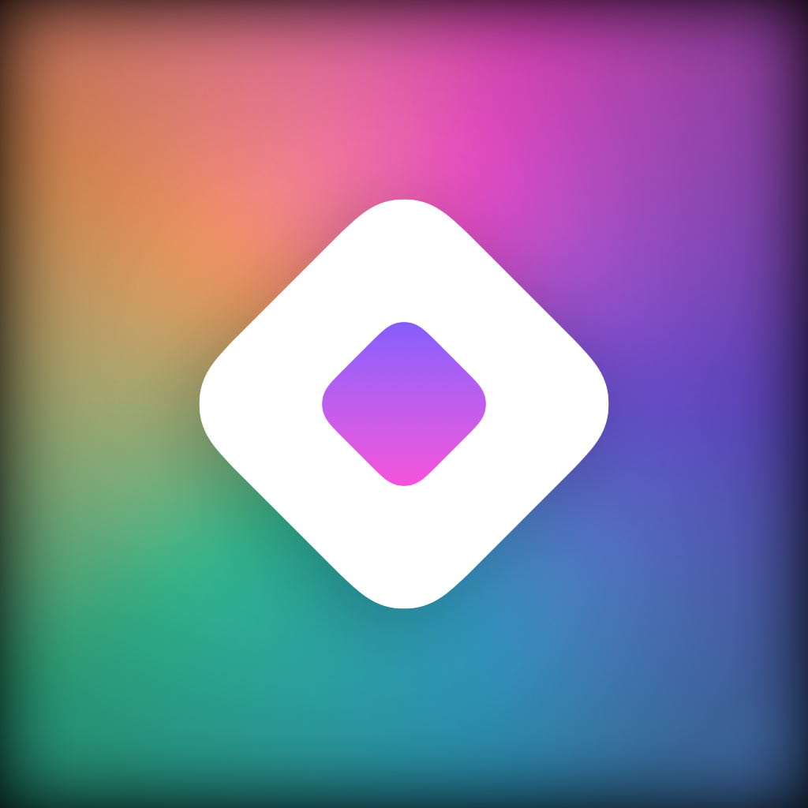
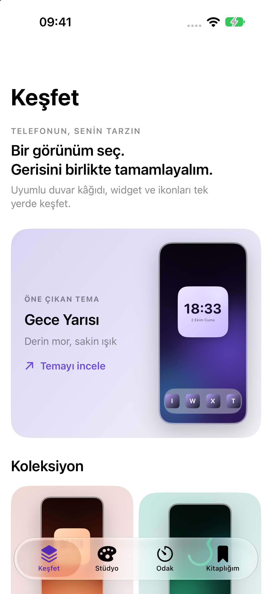
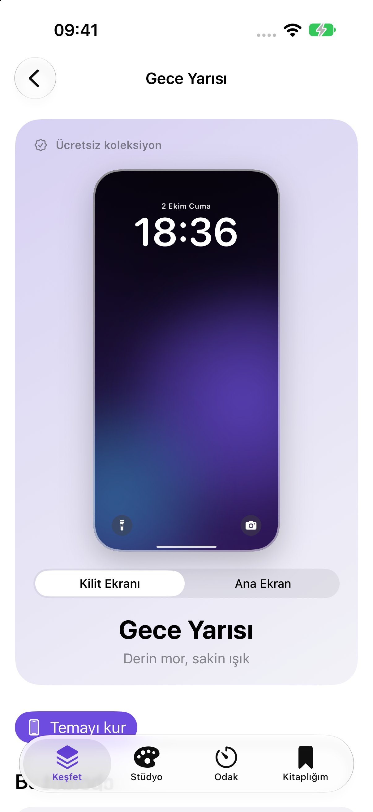
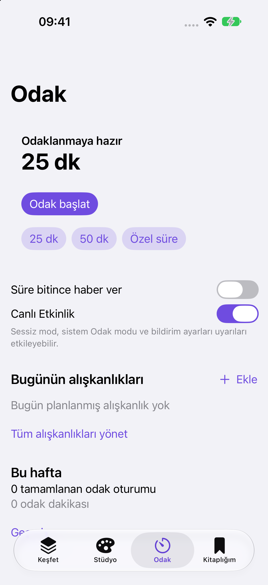

  
  <h1>Prizma</h1>
  
<strong>Your phone. Your style.</strong>

  
A theme, widget, wallpaper and icon studio for iPhone.

  
iOS 26+ · SwiftUI · In development

  
<a href="README.md">Türkçe</a> · <a href="https://github.com/Mahmutakin99/Prizma-showcase/issues">Feedback</a>

---

Prizma brings coordinated iPhone personalization into one place. Start with a theme, then make its wallpaper, widgets and icons your own. Library keeps your projects and setup progress together. Focus adds work and break sessions, daily habits and activity history.

This repository is the app's **public showcase and feedback space**. Source code is maintained separately in a private repository.

## Explore the app

<table>
  <tr><td align="center" width="33%"><strong>Discover</strong></td><td align="center" width="33%"><strong>Theme details</strong></td><td align="center" width="33%"><strong>Focus</strong></td></tr>
  <tr>
    <td></td>
    <td></td>
    <td></td>
  </tr>
</table>

These are actual Turkish-language screens captured from a development build on an iPhone 18 Pro / iOS 27 simulator. The phone shown within theme details is the app's own preview. Screenshots do not indicate an App Store release or physical-device validation. [Capture details](assets/screenshots/README.md).

## Features

- **Discover:** coordinated theme collections with wallpaper, widget and icon previews.
- **Studio:** palette, text, layer and photo editing, with undo/redo and draft recovery in supported editors.
- **Widgets:** designs for Home Screen and Lock Screen surfaces, with optional permissions for relevant data.
- **Wallpapers and icons:** personalize and export visuals, then follow iOS and Shortcuts setup guides.
- **Library:** saved projects, setup progress and `.prizma` project transfers.
- **Focus:** work/break sessions, daily habits and activity history.

Some content and advanced editing options require Premium access. On-device AI theme suggestions depend on Apple Intelligence support and model availability; real-device output evaluation is pending.

## From theme to Home Screen

1. Choose a theme in Discover.
2. Customize its colors and visuals in Studio.
3. Apply the wallpaper in iOS settings, add widgets through the system gallery and follow the Shortcuts guide for icons.
4. Return to Library to keep editing and track setup progress.

Icons are not replaced automatically. Wallpaper application and widget installation require user actions in iOS.

## Availability

Prizma is **in development**. There is currently no App Store download link or public TestFlight invitation in this repository. The minimum deployment target is iOS 26.

Physical-device acceptance checks for widget setup, notifications and Live Activities remain in progress. Purchases and optional iCloud synchronization still require release configuration and live-environment validation.

## Feedback and rights

[Report a bug](https://github.com/Mahmutakin99/Prizma-showcase/issues/new?template=bug-report.yml) or [suggest an improvement](https://github.com/Mahmutakin99/Prizma-showcase/issues/new?template=feature-request.yml). Include your device, iOS version and steps to reproduce; remove personal information from attachments.

© 2026 Mahmut AKIN. All rights reserved. This showcase does not grant an open-source license for the app, its branding or repository contents. [Usage notice](NOTICE.md).
